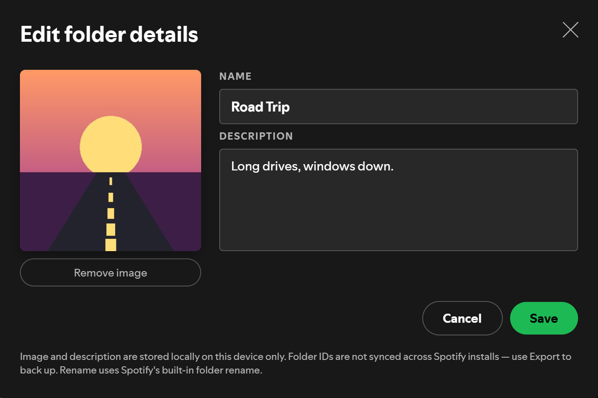

# Spicetify Enhanced Folders

<!-- site:skip-start -->
**Documentation:** https://spicetify.yusufaf.dev/enhanced-folders/
<!-- site:skip-end -->

Add custom images, descriptions, and inline rename to Spotify playlist folders — the metadata Spotify never exposed natively.

[](https://github.com/yusufaf/spicetify-enhanced-folders/releases)
[](LICENSE)



## Known issue

On Spotify 1.3.4, folder images don't show in the sidebar, and the **Folders** chip fails with "library list not found" ([#7](https://github.com/yusufaf/spicetify-enhanced-folders/issues/7)). Images, descriptions and renames are still saved. Descriptions still show on hover, and images show in the Edit folder details dialog.

## Features

- **Custom image per folder** — replaces the default folder icon in the sidebar with any image you upload (auto-cropped to a 354px JPEG, ~150 KB). Not working on Spotify 1.3.4, see [Known issue](#known-issue)
- **Custom description** — free-text per folder, shown as a hover tooltip on the sidebar row
- **Inline rename** — change the folder name from the same dialog (uses `Spicetify.Platform.RootlistAPI.renameFolder`, no need to open Spotify's separate Rename dialog)
- **Folders filter chip** — a **Folders** chip in the sidebar filter bar (next to Playlists, Albums, …) that swaps the library list for a folders-only view; click a folder to expand its playlists inline. Click any native chip to return to Spotify's list. Not working on Spotify 1.3.4, see [Known issue](#known-issue)
- **One context-menu entry** — right-click any folder → **Edit folder details**; image picker + description + name fields in one modal
- **Profile-dropdown settings panel** — Export / Import folder data as JSON, clean up stale entries, force re-render
- **Theme-aware** — uses Spice CSS variables so the UI matches the active Spicetify theme (parity with Album Length, Listening List, Enhanced Pins)
- **Robust against Spotify UI churn** — multi-strategy URI lookup and selector fallbacks; debounced `MutationObserver` so sidebar re-renders don't thrash

## How It Works

Spotify treats playlist folders as client-side rootlist nodes; they have no first-class metadata API and no native edit dialog. This extension:

1. Enumerates folders via `Spicetify.Platform.RootlistAPI.getContents()` (the modern Platform API — the legacy `sp://core-playlist/v1/rootlist` Cosmos endpoint no longer resolves in current Spotify)
2. Registers an `Edit folder details` item in the folder context menu via `Spicetify.ContextMenu`
3. Persists per-folder image (base64 JPEG, square-cropped to ~354px) and description in `Spicetify.LocalStorage`, keyed by folder ID
4. Decorates the sidebar by finding each folder row via its `#listrow-title-<uri>` element, then overlaying the user's image inside the existing artwork container (forces `position: relative` on the slot at decoration time so the absolutely-positioned image stays bounded)
5. Renames via the protobuf-backed `RootlistAPI.renameFolder({uri}, name)` modification, which dispatches a rootlist-changed event that Spotify's React tree picks up automatically — no manual refresh needed

## Installation

Requires [Spicetify](https://spicetify.app/docs/getting-started), installed and applied at least once, and the Spotify desktop app (the web player isn't supported). The Marketplace route also needs the [Spicetify Marketplace](https://spicetify.app/docs/customization/marketplace) custom app.

### From Spicetify Marketplace

1. In Spotify, open **Marketplace** (the shopping-cart icon at the top left) and stay on the **Extensions** tab.
2. Search for `Enhanced Folders`. If it doesn't show up, click **Load more** (» at the bottom of the list) until it does. Marketplace loads extensions in batches and only searches the ones it has loaded.
3. Hover the **Enhanced Folders** card, click its download button, then click **Reload now**.

### Manually

1. Download [`enhanced-folders.js`](https://raw.githubusercontent.com/yusufaf/spicetify-enhanced-folders/main/enhanced-folders.js) (right-click → **Save link as…**) into your Spicetify `Extensions` folder:
   - Windows: `%APPDATA%\spicetify\Extensions`
   - macOS / Linux: `~/.config/spicetify/Extensions`
2. Enable it and apply:

   ```bash
   spicetify config extensions enhanced-folders.js
   spicetify apply
   ```

To confirm it loaded, open DevTools (`Ctrl+Shift+J`, requires `spicetify enable-devtools`) and look for `[Enhanced Folders] Booted.` in the console.

## Usage

Right-click any playlist folder in the sidebar → **Edit folder details** → upload an image, type a description, optionally rename, save.

| Action | Where |
| --- | --- |
| Edit folder image / description / name | Folder right-click → **Edit folder details** |
| Export folder data as JSON | Profile dropdown (top-right avatar) → **Enhanced Folders** → Export |
| Import folder data | Profile dropdown → **Enhanced Folders** → Import (Merge or Replace) |
| Clean up entries for deleted folders | Profile dropdown → **Enhanced Folders** → Clean up deleted folders |
| Force a sidebar re-render | Profile dropdown → **Enhanced Folders** → Re-render sidebar |

## Backup & Sync

Folder IDs are local to each Spicetify install — they don't sync across devices via Spotify. To move customizations between machines, **Export** to JSON on the source machine and **Import** on the target.

The export format is a single JSON document keyed by folder ID:

```json
{
  "schemaVersion": 1,
  "folders": {
    "bcc91019a404b0f3": {
      "image": "data:image/jpeg;base64,/9j/...",
      "description": "Workout playlists",
      "updatedAt": 1748131200000
    }
  }
}
```

## Troubleshooting

- **Image isn't appearing in the sidebar** — on Spotify 1.3.4 this is the [known issue](#known-issue). On other versions, open DevTools (`Ctrl+Shift+J`). If you see `[Enhanced Folders] no rows matched for N stored folder(s)`, the parent folder might be collapsed — expand it. If decoration consistently fails after a Spotify update, file an issue with your Spotify version and a snippet of a folder row's HTML.
- **Rename toast says "API unavailable"** — the `RootlistAPI.renameFolder` signature changed in your Spotify version. File an issue with your Spotify version; image/description save will still work.
- **Customizations missing on another device** — expected. Folder IDs are local. Use Export / Import.
- **Lost data after Spotify reinstall** — same reason. Back up via Export regularly.

## Compatibility

Tested against Spotify desktop on Windows with the YourLibraryX sidebar (list view). On Spotify 1.3.4.258 the artwork-slot and list-root selectors below match nothing, so sidebar images and the Folders view don't render ([#7](https://github.com/yusufaf/spicetify-enhanced-folders/issues/7)). Selectors used:
- Row lookup: `#listrow-title-<uri>` → `.closest('.main-yourLibraryX-listItem, li, [role="treeitem"]')`
- Artwork slot: `.x-entityImage-imageContainer` / `.main-cardImage-imageWrapper` / `.main-yourLibraryX-listItemArtwork` / `[data-testid="entity-image"]` (first match wins)
- Rootlist enumeration: `Spicetify.Platform.RootlistAPI.getContents()`
- Rename: `Spicetify.Platform.RootlistAPI.renameFolder({uri}, newName)`
- Folders filter chip bar: `[role="listbox"][aria-label="Filter options"]` (react-aria listbox). Each native chip carries `data-encore-id="chip"`; the Folders chip is a clone of one, with the native `e-10451-legacy-chip--selected` classes toggled for its active look
- Folders filter list root (hidden while the Folders view is active): `.main-yourLibraryX-libraryRootlist` / `[data-testid="rootlist"]` / `.main-yourLibraryX-libraryItemContainer` / `.main-yourLibraryX-listItemContainer`

If Spotify renames these classes in a future build, decoration will silently no-op (no errors thrown) and the issue will be a selector update.

## Contributing

See [CONTRIBUTING.md](./CONTRIBUTING.md).

## License

MIT — see [LICENSE](./LICENSE).

## Acknowledgments

- [SunsetTechuila/imaged-folders](https://github.com/SunsetTechuila/imaged-folders) — prior art for folder images (now archived); selector patterns referenced here
- [Dribbblish theme](https://github.com/spicetify/spicetify-themes/tree/master/Dribbblish) — first to introduce folder images, theme-locked
- [bespoke-alpha/stdlib](https://github.com/bespoke-alpha/stdlib) — auto-generated Spotify Platform type definitions, invaluable for reverse-engineering `renameFolder`'s signature
